# Simulator

Currency pills, big shop cards, icon sets and bright sky-blue simulator HUDs.

17 images.

## Original mockups

Mockups are original illustrations made for this collection. Lettering uses the Kenney Future font (CC0).

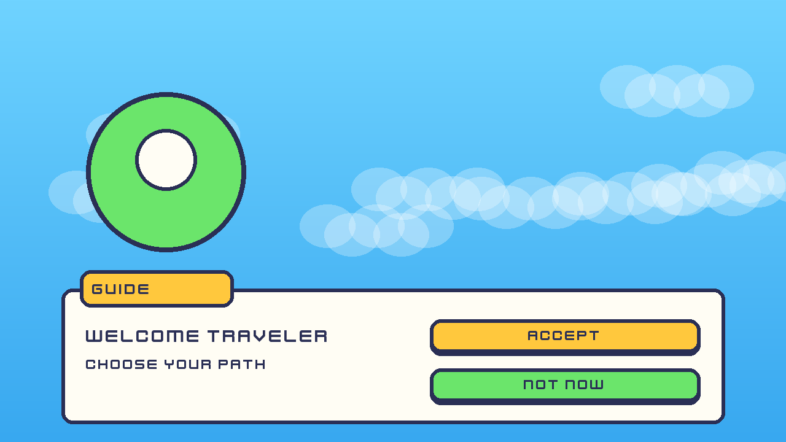

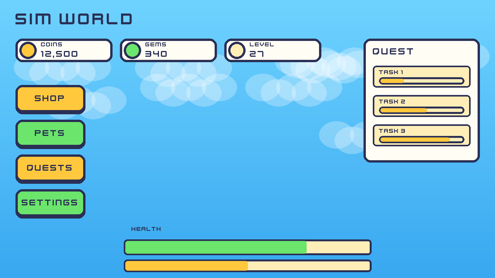

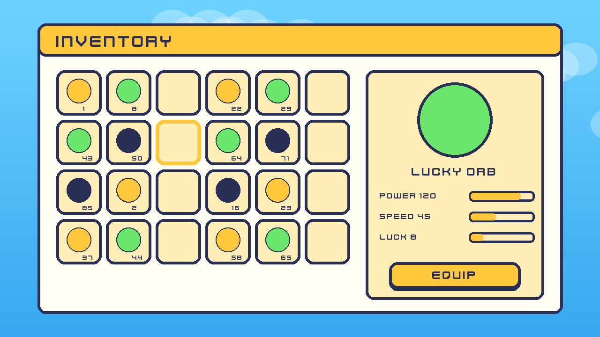

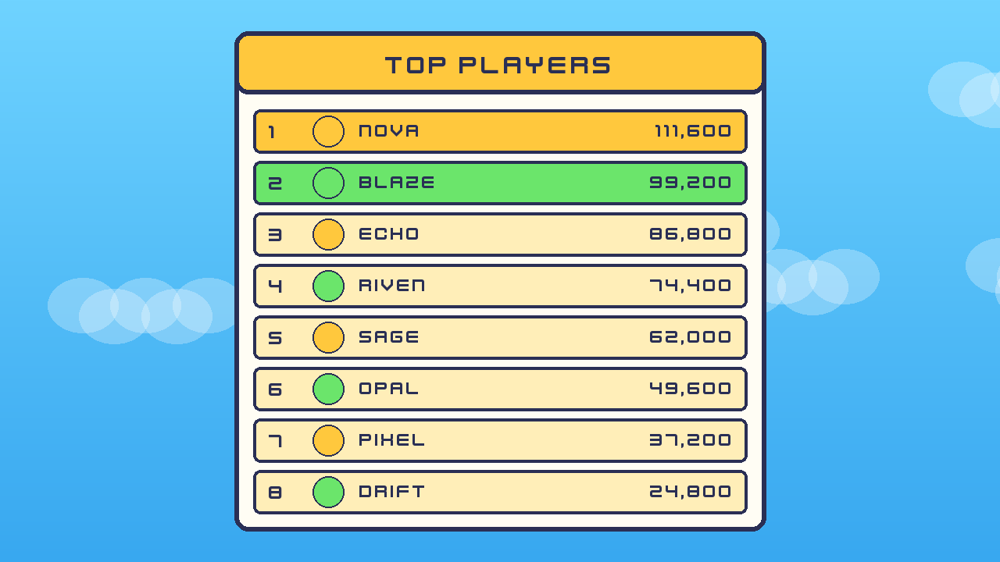

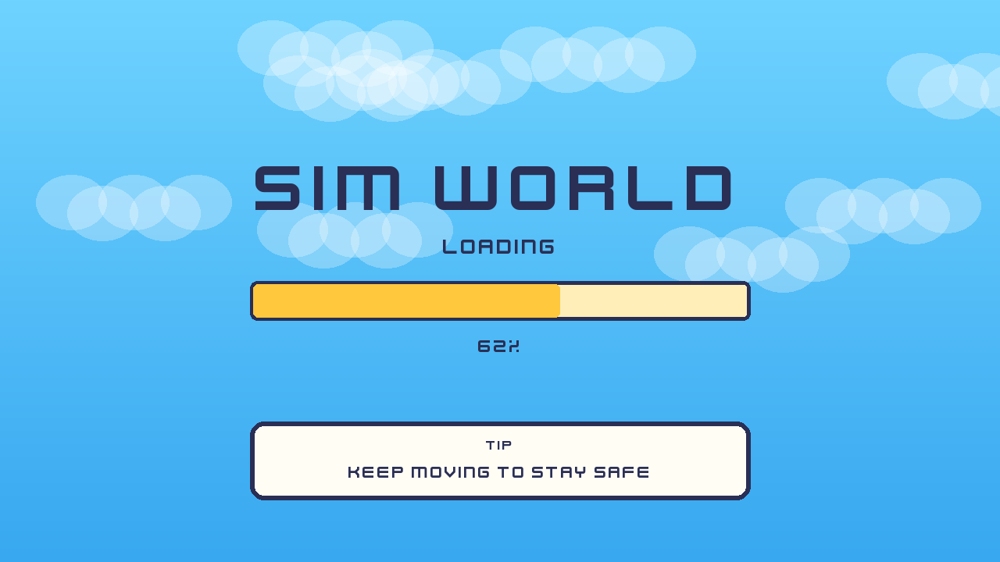

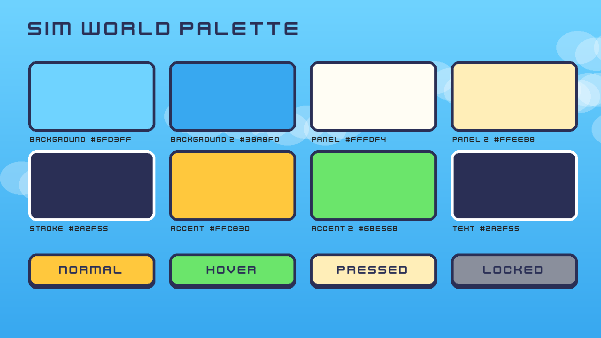

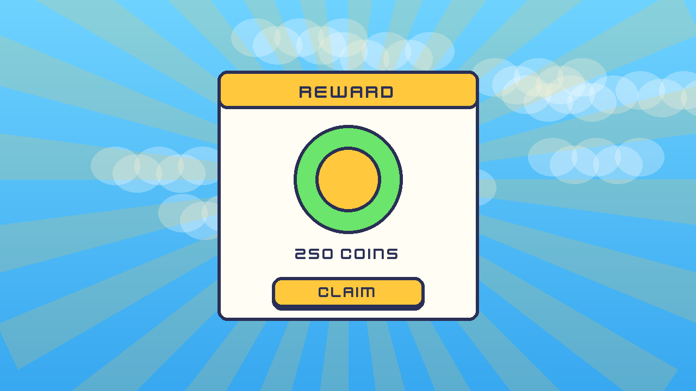

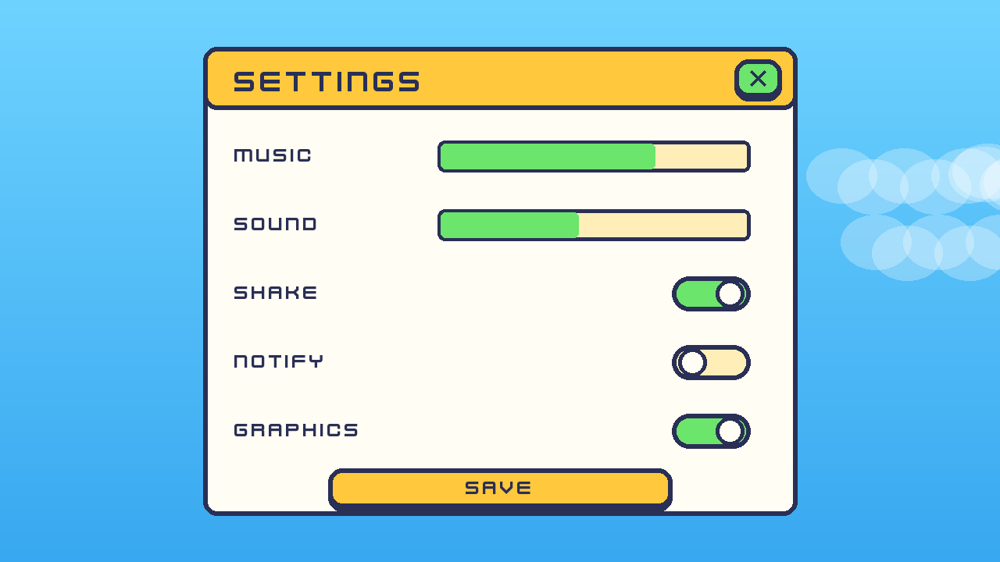

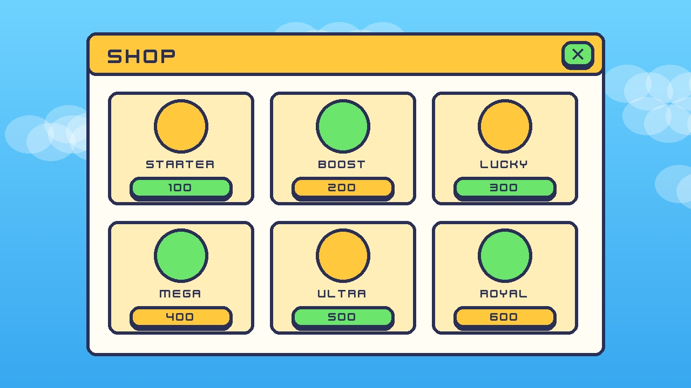

## Pack previews

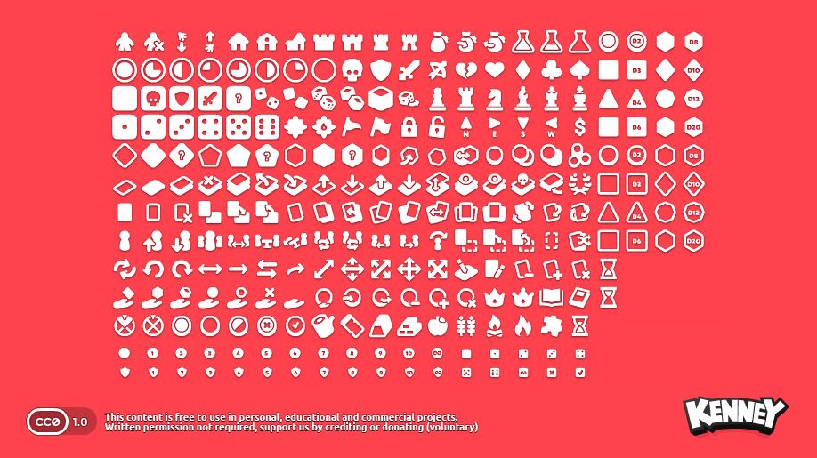

## Contact sheets

Every sprite of a group laid out on one image, so a whole set can be seen at a glance.

### board game icons 64px 1

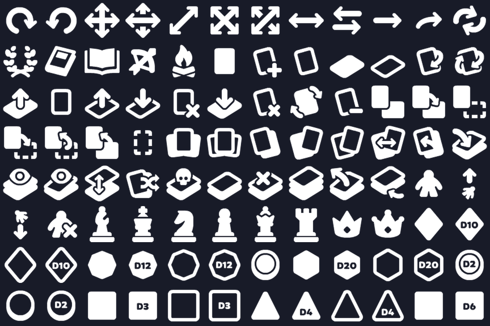

### board game icons 64px 2

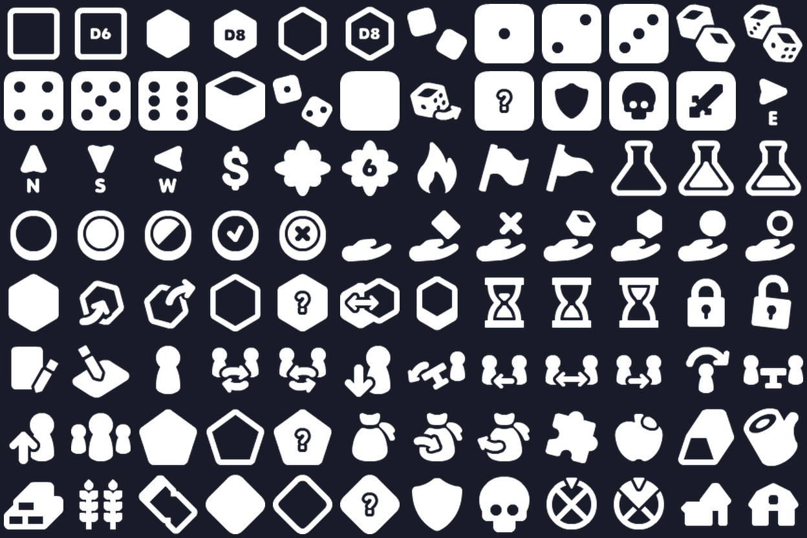

### board game icons 64px 3

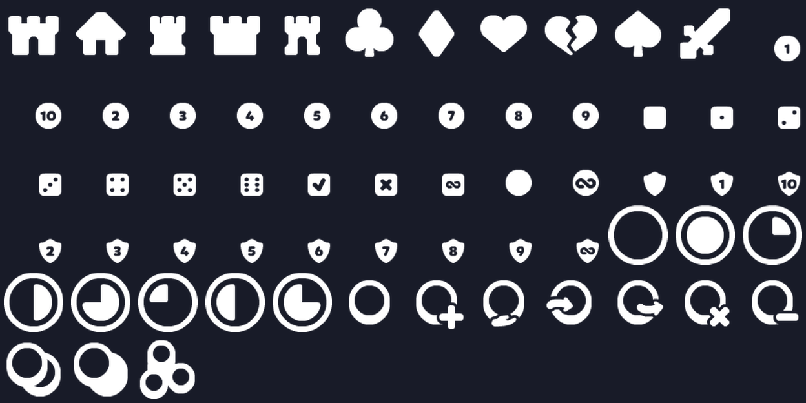

### game icons black 1x 1

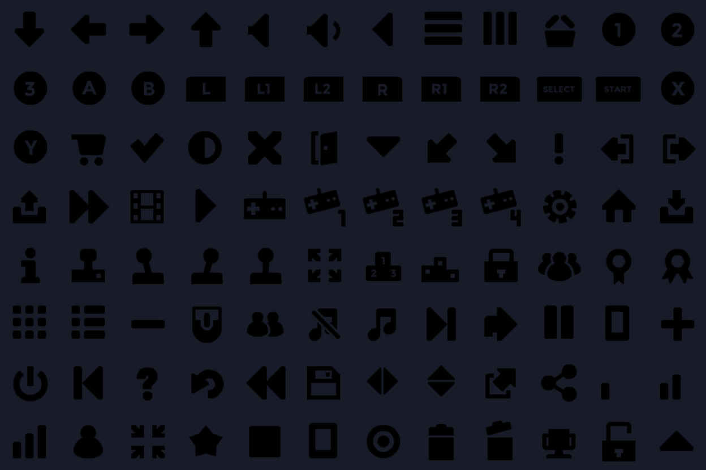

### game icons black 1x 2

### game icons white 1x 1

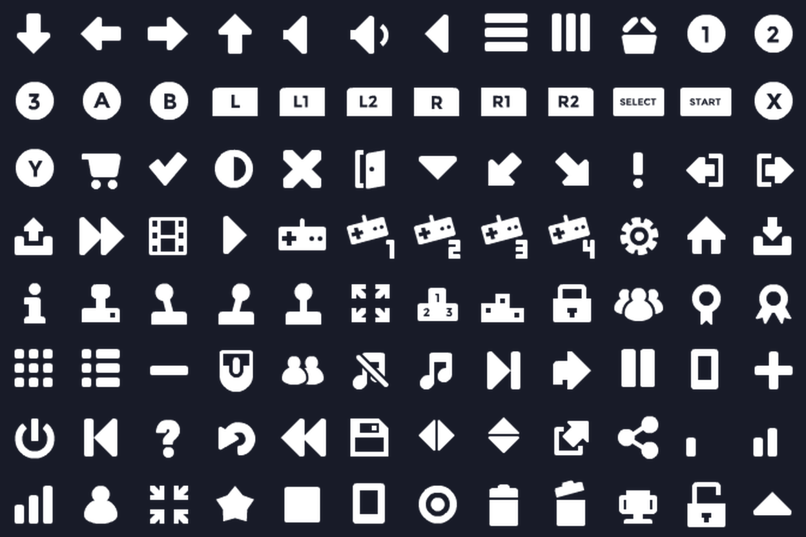

### game icons white 1x 2

Contact sheets and preview images come from Kenney asset packs (https://kenney.nl), released under CC0 1.0 (public domain). Credit is not required but is given here.
